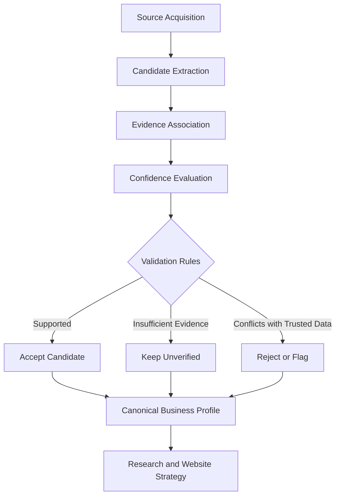

# `WEBLOOM.exe`

<p align="center">
  
</p>

<p align="center">
  <strong>LOCAL BUSINESS INTELLIGENCE. ENGINEERED FROM EVIDENCE.</strong>
  <br/>
  Turning raw business URLs into researched intelligence, digital audits, and personalized web experiences.
</p>

<p align="center">
  
  
  
</p>

<p align="center">
  <a href="#-system-overview">SYSTEM</a> ·
  <a href="#-technology-stack">TECH STACK</a> ·
  <a href="#-data-pipeline">DATA PIPELINE</a> ·
  <a href="#-research--benchmarks">BENCHMARKS</a> ·
  <a href="#-engineering-roadmap">ROADMAP</a>
</p>

---

> `BOOT SEQUENCE INITIATED`
>
> `LOADING BUSINESS INTELLIGENCE MODULES...`
>
> `INITIALIZING EVIDENCE PIPELINE...`
>
> `STATUS: READY FOR INPUT`

## `01 // WHAT IS WEBLOOM?`

**Webloom is an AI-powered business intelligence and website generation pipeline developed by The Fables Lab.**

It starts with a business discovery input, such as a Google Maps URL, and works toward a structured, evidence-backed understanding of that business. The resulting information can support digital presence audits, brand research, website strategy, and personalized landing-page specifications.

Instead of treating an AI model's first response as truth, Webloom is designed around a more rigorous principle:

**Extract. Research. Validate. Preserve evidence. Then generate.**

The system combines structured geospatial data, website extraction, AI-assisted enrichment, confidence-aware field candidates, and provenance tracking to reduce unsupported claims and protect reliable source data.

<details>
<summary><strong>▸ SYSTEM BRIEFING // READ THE MISSION</strong></summary>

Traditional website generation often begins with a prompt and a generic template. That approach ignores a major problem: a website is only as useful as the information behind it.

Webloom addresses the upstream problem.

Before a business website is generated, the system needs to understand what the business does, what information can be verified, how the brand presents itself, what its digital presence looks like, and what information is still missing.

Webloom aims to turn that research process into a structured, repeatable engineering pipeline.

The intended output is not merely generated HTML. It is a researched business profile that can inform a more relevant digital experience.

</details>

---

## `02 // SYSTEM OVERVIEW`

```text
┌───────────────────────────────────────────────────────────┐
│                    WEBLOOM INTELLIGENCE                   │
├───────────────────────────────────────────────────────────┤
│                                                           │
│  INPUT                                                    │
│  └── Google Maps URL / Business Information               │
│                         │                                 │
│                         ▼                                 │
│  DISCOVERY                                                │
│  ├── GoogleMapsUrlParserProvider                          │
│  ├── Geoapify                                             │
│  └── OfficialWebsiteProvider                              │
│                         │                                 │
│                         ▼                                 │
│  EXTRACTION                                               │
│  ├── Website Content Retrieval                            │
│  ├── BusinessDataExtractor                                │
│  └── CandidatePipeline                                    │
│                         │                                 │
│                         ▼                                 │
│  INTELLIGENCE                                             │
│  ├── BusinessResearchService                              │
│  ├── DigitalAuditService                                  │
│  ├── BrandStrategyService                                 │
│  └── WebsiteStrategyService                               │
│                         │                                 │
│                         ▼                                 │
│  VALIDATION                                               │
│  ├── FieldCandidate                                       │
│  ├── EvidenceModels                                       │
│  ├── BusinessProfile                                      │
│  └── Provenance & Confidence                              │
│                         │                                 │
│                         ▼                                 │
│  GENERATION                                               │
│  ├── LandingPageSpecService                               │
│  └── Personalized Website Specification                   │
│                                                           │
└───────────────────────────────────────────────────────────┘
```

<details>
<summary><strong>▸ EXPAND // PIPELINE DESIGN RATIONALE</strong></summary>

The pipeline separates business discovery, content extraction, research, validation, and generation into distinct responsibilities.

This separation matters because an extraction failure should not silently become a generation success. If a source does not provide a phone number, the system should not invent one merely to complete a field.

The architecture uses provider abstractions to separate data acquisition from downstream processing. This makes it possible to change individual sources without redesigning the entire pipeline.

</details>

---

## `03 // TECHNOLOGY STACK`

The stack is built around JavaScript-based application development, structured data acquisition, and AI-assisted research.

### Application layer

| Technology | Role |
|:--|:--|
| **Node.js** | Server-side JavaScript runtime |
| **Express.js** | API and backend application layer |
| **React** | Frontend application interface |
| **Vite** | Frontend development and build tooling |
| **Astro** | Website-generation tooling where configured |
| **JavaScript / TypeScript** | Application logic and typed service development where used |

### Data acquisition and research

| Technology | Role |
|:--|:--|
| **Geoapify** | Geospatial and place-data provider |
| **Google Maps URL parsing** | Business input identification and URL processing |
| **OfficialWebsiteProvider** | Website-based source acquisition |
| **`r.jina.ai`** | Website-content extraction proxy |
| **BusinessDataExtractor** | Business-field extraction |
| **CandidatePipeline** | Candidate processing and field selection |

### AI and intelligence

| Technology | Role |
|:--|:--|
| **OpenRouter** | Hosted model-provider integration |
| **Google Gemini** | AI-assisted research and enrichment |
| **Local model provider** | Optional fallback architecture when configured |
| **Provider abstraction** | Separation of model routing from application logic |
| **Confidence and provenance models** | Evidence-aware field validation |

### Engineering and delivery

| Technology | Role |
|:--|:--|
| **Git / GitHub** | Source control and project collaboration |
| **Environment variables** | Provider configuration and secret management |
| **Automated tests** | Validation of extraction and pipeline behavior |
| **Health endpoints** | Provider and application diagnostics |

*Stack accuracy note: technologies and services listed here reflect the project's known architecture and development history. A component's presence in the architecture does not necessarily mean every deployment currently uses it. Verify the active branch and dependencies before treating this table as a complete production inventory.*

---

## `04 // THE INTELLIGENCE MODULES`

### `MODULE_01` — Business discovery

**Input:** A business URL or supplied business information.

The discovery layer identifies the business input, parses available identifiers, and prepares information for downstream source acquisition.

Key components:

- `GoogleMapsUrlParserProvider`
- `OfficialWebsiteProvider`
- `UserProvidedDataProvider`
- Geoapify integration

The provider architecture reduces dependence on a single source and supports different acquisition strategies.

### `MODULE_02` — Evidence-aware extraction

**Objective:** Extract structured business information without treating every candidate as a verified fact.

The extraction layer is designed to distinguish what a source explicitly states from what a model merely suggests.

Key components:

- `BusinessDataExtractor`
- `BusinessDataExtractorQualityAdapter.js`
- `FieldCandidate`
- `CandidatePipeline`
- `EvidenceModels.js`

Extracted fields can be evaluated using source evidence, provenance, and confidence information before entering the canonical business profile.

### `MODULE_03` — Business research

**Objective:** Build a richer business profile from available information.

`BusinessResearchService` supports the research and enrichment stage, supplying structured information to downstream analysis.

The design aims to make business profiles more useful than a collection of scraped strings by preserving the context and origin of extracted fields.

### `MODULE_04` — Digital presence audit

**Objective:** Understand the current state of a business's digital presence.

`DigitalAuditService` provides the architectural foundation for analyzing available website and business information.

Potential audit dimensions include:

- Information completeness.
- Brand consistency.
- Website content and structure.
- Customer-facing information quality.
- Opportunities for a more effective digital experience.

Actual audit coverage depends on the checks implemented in the active version.

### `MODULE_05` — Brand intelligence

**Objective:** Convert research into useful brand direction.

`BrandStrategyService` and `WebsiteStrategyService` support the translation of business information into a brand and website strategy.

Rather than generating an arbitrary design first, the intended approach is to ground website decisions in the business's identity, offerings, and available evidence.

### `MODULE_06` — Landing-page specification

**Objective:** Produce a structured specification for a personalized website.

`LandingPageSpecService` forms part of the final stage of the research pipeline.

The specification can inform website structure, content priorities, visual direction, and business-specific messaging before the actual website is generated.

---

## `05 // DATA PIPELINE`

Webloom's most important engineering principle is that **a plausible value is not automatically a correct value**.

### Provenance model

The system has used the following provenance categories:

| Provenance | Meaning |
|:--|:--|
| `IDENTIFIED` | Information associated with an identified entity or source |
| `DISCOVERED` | Information discovered during research or extraction |
| `VERIFIED` | Information that has passed the applicable verification process |
| `user_provided` | Information explicitly supplied by the user |

These categories should remain semantically distinct. In particular, discovering a field does not automatically mean it has been independently verified.

### Field validation lifecycle



<details>
<summary><strong>▸ EXPAND // WHY PROVENANCE MATTERS</strong></summary>

A business profile may contain information from several sources, and those sources may disagree.

A robust extraction pipeline needs to preserve enough context to answer:

- Where did this value come from?
- What evidence supports it?
- Was it supplied directly or inferred?
- How confident is the system?
- Does it conflict with a previously trusted value?
- Should it be accepted, rejected, or flagged for review?

These questions are essential for reducing hallucinations and maintaining trustworthy downstream generation.

</details>

---

## `06 // AI PROVIDER RESILIENCE`

Webloom's AI integration has evolved from a gateway-based approach toward a provider abstraction with a direct fallback chain.

### Provider architecture

```text
                 WEBLOOM AI REQUEST
                         │
                         ▼
                PROVIDER ORCHESTRATION
                         │
             ┌───────────┴───────────┐
             ▼                       │
        OpenRouter                  │
             │                       │
       Success / Failure             │
             │                       │
             ▼                       ▼
          Gemini                Local Model
             │
        Success / Failure
             │
             ▼
      Structured Result /
      Explicit Unavailable State
```

The diagram represents the intended provider strategy, not a guarantee that all providers are currently operational.

### Resilience objectives

- Keep provider-specific configuration outside business logic.
- Distinguish authentication errors from rate limits and quota exhaustion.
- Apply bounded retries and timeouts.
- Avoid retrying permanent failures unnecessarily.
- Report provider readiness separately from simple connectivity.
- Preserve a usable non-AI path when enrichment is unavailable.
- Never treat a provider error as successful research.

### Health diagnostics

The AI health endpoint has been designed to report provider-level readiness, including configuration, reachability, authentication, and usability.

A configured API key does not guarantee a usable model. Providers may reject requests because of quota exhaustion, temporary capacity constraints, invalid model names, or upstream outages.

**Operational rule:** An unavailable AI provider should produce an explicit degraded state, not fabricated research.

---

## `07 // RESEARCH & BENCHMARKS`

### Phase 2 extraction benchmark

The following figures were recorded during a previous project benchmark. They are historical project-reported results, not an independently audited or guaranteed production performance claim.

<p align="center">
  
  
</p>

| Metric | Recorded result |
|:--|--:|
| Total field observations | 224 |
| Field extraction correctness | 96.9% |
| Confidence calibration | 100% |
| Provider agreement rate | 96.9% |
| AI hallucination rejection | 100% |
| AI overwrite protection | 100% |

### What the metrics mean

- **Extraction correctness:** The observed proportion of evaluated field extractions judged correct.
- **Confidence calibration:** The reported score for the benchmark's confidence-calibration criterion. The exact methodology and denominator should accompany any formal publication.
- **Provider agreement:** The observed agreement rate under the benchmark's comparison procedure.
- **Hallucination rejection:** The reported rejection result for evaluated unsupported AI-generated values.
- **Overwrite protection:** The reported result for evaluated cases where protected existing data should not be overwritten.

A benchmark of 224 observations is useful evidence for development, but it is not enough to establish universal reliability across industries, languages, source types, or changing websites.

For reproducible evaluation, future benchmark reports should include the dataset, sampling method, field-level labels, denominators, failure categories, and evaluation scripts.

---

## `08 // REPOSITORY MAP`

The application has been developed around a modular service architecture. The following is a conceptual map of the known modules, not a claim that every directory is present at the repository root.

```text
webloom/
├── apps/
│   ├── api/
│   │   ├── providers/
│   │   │   ├── OfficialWebsiteProvider
│   │   │   ├── UserProvidedDataProvider
│   │   │   └── GoogleMapsUrlParserProvider
│   │   ├── services/
│   │   │   ├── BusinessDataExtractor
│   │   │   ├── BusinessResearchService
│   │   │   ├── DigitalAuditService
│   │   │   ├── BrandStrategyService
│   │   │   ├── WebsiteStrategyService
│   │   │   └── LandingPageSpecService
│   │   ├── models/
│   │   │   ├── EvidenceModels
│   │   │   └── BusinessProfile
│   │   └── .env
│   └── web/
│       └── React / Vite application
├── tests/
├── package.json
└── README.md
```

Adapt this tree to the actual repository before publishing. File names and paths should be copied from the codebase rather than inferred from service names.

---

## `09 // ENGINEERING ROADMAP`

<details open>
<summary><strong>[01] DATA QUALITY & EVIDENCE</strong></summary>

- [ ] Expand field-level evaluation datasets.
- [ ] Improve source conflict resolution.
- [ ] Track evidence quality and freshness.
- [ ] Test extraction against missing and contradictory information.
- [ ] Publish reproducible benchmark reports.

</details>

<details>
<summary><strong>[02] PROVIDER RELIABILITY</strong></summary>

- [ ] Verify provider-specific health checks.
- [ ] Implement bounded retries and circuit-breaking where appropriate.
- [ ] Separate quota exhaustion from transient failures.
- [ ] Add deterministic fallback behavior.
- [ ] Test the application with all AI providers unavailable.

</details>

<details>
<summary><strong>[03] RESEARCH & AUDITING</strong></summary>

- [ ] Improve business-profile completeness checks.
- [ ] Strengthen digital presence audit coverage.
- [ ] Connect brand research to evidence-backed website strategy.
- [ ] Add structured failure reports and source attribution.
- [ ] Evaluate generated specifications against reference cases.

</details>

<details>
<summary><strong>[04] PRODUCT & OPERATIONS</strong></summary>

- [ ] Improve job observability and diagnostic reporting.
- [ ] Add regression tests for critical extraction behavior.
- [ ] Document source-provider limitations.
- [ ] Improve deployment and environment validation.
- [ ] Establish a repeatable release and rollback process.

</details>

---

## `10 // SECURITY & RESPONSIBLE DATA ACQUISITION`

Webloom handles third-party business information and external website content. Reliability and security must be treated as engineering requirements, not optional polish.

- **Respect source terms:** Use providers in accordance with their terms, access policies, and applicable law.
- **Validate URLs:** Protect against server-side request forgery, internal network access, and unsafe redirects.
- **Protect secrets:** Never commit API keys or production credentials.
- **Treat extracted content as untrusted:** External pages may contain misleading text, malicious instructions, or prompt-injection attempts.
- **Separate evidence from instructions:** Retrieved website content must never be allowed to override system policies or privileged application behavior.
- **Minimize data retention:** Store only the information required for legitimate product functionality.
- **Make uncertainty visible:** Flag missing, stale, or conflicting information rather than silently inventing a resolution.

---

## `11 // GETTING STARTED`

### Prerequisites

- Node.js and npm compatible with the project's package configuration.
- Git.
- The Webloom repository.
- Provider credentials for any external integrations you intend to use.

### Clone the repository

```bash
git clone <WEBLOOM_REPOSITORY_URL>
cd <WEBLOOM_DIRECTORY>
npm install
```

If the repository is a workspace, install dependencies using the root-level instructions and start the intended application with its documented script.

For example, where the API and web applications define their own development scripts:

```bash
cd apps/api
npm run dev
```

In another terminal:

```bash
cd apps/web
npm run dev
```

These commands are illustrative. Verify the actual package scripts before using them.

### Environment configuration

Configure the providers required by your active deployment through environment variables.

```dotenv
# Geospatial provider
GEOAPIFY_API_KEY=

# AI provider configuration
OPENROUTER_API_KEY=
GEMINI_API_KEY=
GEMINI_MODEL=

# Optional local model configuration
LOCAL_MODEL_BASE_URL=
```

The exact variable names must match the application's current configuration. Do not commit populated `.env` files.

---

## `12 // PROJECT OWNERSHIP`

**Webloom is a proprietary project developed under The Fables Lab.**

Unless otherwise specified by an applicable written agreement, this repository is not offered as an open-source software package. No public license to copy, redistribute, sublicense, or commercially exploit proprietary project materials is granted by this README.

Third-party software remains subject to its own license terms. Ownership of commissioned code and other project deliverables is governed by the applicable agreements and law.

For authorized access, maintenance, or licensing inquiries, contact the relevant project rights holder.

---

## `SYSTEM STATUS // FINAL TRANSMISSION`

```text
┌────────────────────────────────────────────────┐
│ WEBLOOM INTELLIGENCE ENGINE                    │
├────────────────────────────────────────────────┤
│ INPUT        : BUSINESS URL                    │
│ PROCESS      : RESEARCH + EXTRACTION            │
│ VALIDATION   : EVIDENCE + PROVENANCE            │
│ OUTPUT       : BUSINESS INTELLIGENCE            │
│               + WEBSITE SPECIFICATION           │
│ DESIGN       : CYBER-INDUSTRIAL                 │
│ PHILOSOPHY   : EVIDENCE OVER ASSUMPTION         │
└────────────────────────────────────────────────┘
```

**Research the business. Validate the data. Engineer the experience.**

Built by **The Fables Lab**.

*From raw signals to meaningful digital experiences.*

