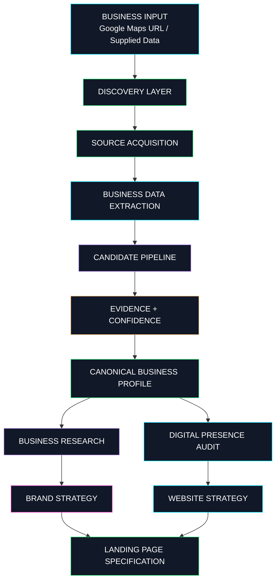
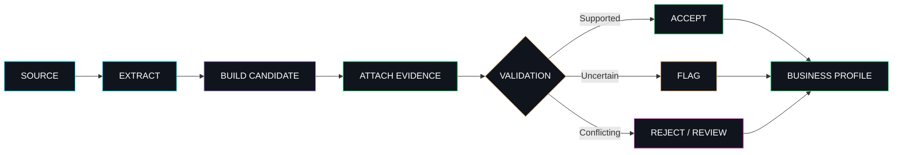

# ⟢ WEBLOOM

<p align="center">
  <a href="https://github.com/TheFablesLab">
    
  </a>
</p>

<p align="center">
  
</p>

<p align="center">
  <strong>RESEARCH THE BUSINESS. VALIDATE THE DATA. ENGINEER THE EXPERIENCE.</strong>
</p>

<p align="center">
  
  
  
</p>

<p align="center">
  <a href="#-overview">OVERVIEW</a> ·
  <a href="#-architecture">ARCHITECTURE</a> ·
  <a href="#-technology-stack">TECH STACK</a> ·
  <a href="#-data-integrity">DATA INTEGRITY</a> ·
  <a href="#-benchmarks">BENCHMARKS</a> ·
  <a href="#-setup">SETUP</a>
</p>

---

<details>
<summary><strong>◈ OPEN SYSTEM BRIEFING</strong></summary>

```text
╔════════════════════════════════════════════════════════════╗
║                    WEBLOOM // CORE                         ║
╠════════════════════════════════════════════════════════════╣
║                                                            ║
║  INPUT       :: GOOGLE MAPS URL / BUSINESS DATA             ║
║  DISCOVERY   :: PLACE IDENTIFICATION + SOURCE ACQUISITION   ║
║  EXTRACTION  :: STRUCTURED BUSINESS INFORMATION            ║
║  RESEARCH    :: BUSINESS + DIGITAL PRESENCE ANALYSIS        ║
║  VALIDATION  :: EVIDENCE + CONFIDENCE + PROVENANCE          ║
║  GENERATION  :: PERSONALIZED WEBSITE SPECIFICATIONS        ║
║                                                            ║
║  DIRECTIVE   :: EVIDENCE OVER ASSUMPTION                    ║
║                                                            ║
╚════════════════════════════════════════════════════════════╝
```

**System objective:** Convert scattered business information into a structured, research-backed foundation for personalized digital experiences.

</details>

## `01` // Overview

**Webloom is an AI-powered business intelligence and website generation pipeline developed under The Fables Lab.**

It transforms a business discovery input, such as a Google Maps URL, into structured business information that can support research, digital presence audits, brand strategy, website planning, and personalized landing-page specifications.

Most website generators start with a prompt and immediately generate a page.

Webloom focuses on the layer before generation: understanding the business, extracting relevant information, evaluating its reliability, and preserving the evidence behind the resulting profile.

The principle is simple:

> **A convincing answer is not necessarily a correct answer.**

Webloom is designed to separate source acquisition, extraction, research, validation, and generation so that uncertainty can be handled explicitly rather than disguised by polished AI-generated copy.

### Core capabilities

| Module | Function |
|:--|:--|
| `BUSINESS_DISCOVERY` | Parse and identify business inputs |
| `DATA_EXTRACTION` | Retrieve and structure business information |
| `BUSINESS_RESEARCH` | Enrich profiles using available evidence |
| `DIGITAL_AUDIT` | Analyze available digital presence information |
| `BRAND_INTELLIGENCE` | Inform brand positioning and creative direction |
| `WEBSITE_STRATEGY` | Translate research into website recommendations |
| `LANDING_PAGE_SPEC` | Produce structured website specifications |
| `AI_ROUTING` | Coordinate configured model providers |

<sub>Capabilities depend on the active implementation, provider availability, and source quality.</sub>

---

## `02` // The visual identity

<p align="center">
  
  
  
  
  
  
</p>

Webloom's visual direction takes inspiration from cyberpunk interfaces, scientific research terminals, observability dashboards, and industrial engineering systems.

- **Void black:** the underlying interface.
- **Phosphor green:** successful validation and trusted signals.
- **Electric cyan:** data movement and active processing.
- **Ultraviolet:** AI intelligence and analytical layers.
- **Neon pink:** warnings, conflicts, and attention states.
- **Signal amber:** uncertainty, retries, and degraded providers.

The colors are a proposed README and brand palette, not a claim that the same color tokens are implemented throughout the product UI.

---

## `03` // Architecture



### Architecture principles

**Provider abstraction**

Data sources and AI providers are isolated behind provider interfaces, allowing individual integrations to change without requiring a complete redesign of downstream services.

**Evidence-aware processing**

Extracted values are evaluated before they become part of a canonical business profile.

**Separation of concerns**

Discovery, research, auditing, strategy, and specification generation are handled by distinct services.

**Graceful degradation**

Unavailable providers should produce explicit errors or degraded states rather than fabricated business information.

**Source-aware generation**

Website specifications should be informed by the available business evidence and distinguish confirmed facts from unresolved details.

---

## `04` // Technology stack

### Application engineering

<p>
  
  
  
  
  
  
</p>

| Technology | Responsibility |
|:--|:--|
| Node.js | Backend JavaScript runtime |
| Express.js | HTTP routing and API infrastructure where configured |
| React | Frontend interface |
| Vite | Frontend development and build tooling |
| JavaScript | Application and service logic |
| TypeScript | Typed application logic in applicable modules |

### Business data acquisition

<p>
  
  
  
</p>

| Component | Responsibility |
|:--|:--|
| Geoapify | Geospatial and place-data acquisition |
| Google Maps URL parser | Input parsing and business identification |
| Official website provider | Website-based information acquisition |
| User-provided data provider | Incorporation of explicitly supplied information |
| `r.jina.ai` | Website-content extraction proxy |

### Intelligence and validation

| Component | Responsibility |
|:--|:--|
| OpenRouter | Hosted AI model routing |
| Google Gemini | AI-assisted research and enrichment |
| Local model provider | Optional local inference fallback when configured |
| `BusinessDataExtractor` | Structured business-field extraction |
| `EvidenceModels` | Evidence representation |
| `BusinessProfile` | Canonical business-profile representation |
| `CandidatePipeline` | Field-candidate processing and selection |

### Development and operations

<p>
  
  
  
</p>

The project also uses environment-based provider configuration, application health checks, and automated evaluation of extraction quality.

<sub>Technology badges identify technologies associated with the known project architecture. They are not live dependency checks. Confirm package manifests and active integrations before claiming that every component is present in a particular release.</sub>

---

## `05` // Data integrity protocol

The most important part of Webloom is not the model. It is the process that determines which model outputs deserve to be trusted.

### Provenance classification

| Provenance | Interpretation |
|:--|:--|
| `IDENTIFIED` | Associated with an identified entity or source |
| `DISCOVERED` | Found during discovery or extraction |
| `VERIFIED` | Passed the applicable verification process |
| `user_provided` | Explicitly supplied by the user |

These categories describe different states and should not be treated as interchangeable.

A discovered phone number is not automatically verified. A model's confidence is not proof. Agreement between two providers is not necessarily independent confirmation if both rely on the same underlying source.

### Candidate validation lifecycle



### Data integrity objectives

- Preserve source attribution for extracted information.
- Distinguish source-backed facts from model-generated suggestions.
- Prevent lower-confidence candidates from silently replacing protected values.
- Represent missing and contradictory information explicitly.
- Keep verification criteria consistent across providers.
- Avoid generating unsupported business details merely to fill a template.

---

## `06` // AI provider orchestration

Webloom has evolved toward a provider chain using OpenRouter, Gemini, and an optional local provider.

```text
                 ┌────────────────────────┐
                 │   WEBLOOM AI REQUEST   │
                 └───────────┬────────────┘
                             │
                             ▼
                 ┌────────────────────────┐
                 │ PROVIDER ORCHESTRATION │
                 └───────────┬────────────┘
                             │
                             ▼
                      ┌────────────┐
                      │ OpenRouter │
                      └─────┬──────┘
                            │ Failure
                            ▼
                      ┌────────────┐
                      │   Gemini   │
                      └─────┬──────┘
                            │ Failure
                            ▼
                      ┌────────────┐
                      │   Local    │
                      │  Provider  │
                      └─────┬──────┘
                            │
                            ▼
                   ┌──────────────────┐
                   │ RESULT OR EXPLICIT│
                   │ UNAVAILABLE STATE │
                   └──────────────────┘
```

The diagram illustrates the intended fallback strategy. Actual routing order, eligibility, and fallback behavior depend on the active configuration and implementation.

### Failure handling

| Failure | Expected handling |
|:--|:--|
| Invalid credentials | Report an authentication failure |
| Exhausted quota | Mark the provider rate-limited or unavailable |
| Temporary upstream failure | Apply bounded retries where appropriate |
| Unsupported model | Report configuration failure |
| Timeout | Stop waiting and apply the configured fallback policy |
| All providers unavailable | Return an explicit failure or supported non-AI result |

A reachable endpoint is not necessarily a usable model. Likewise, an API key being accepted does not guarantee that requests can be completed within the provider's quota or capacity limits.

The system should never convert a provider failure into invented research.

---

## `07` // Research benchmarks

### Historical extraction evaluation

<p align="center">
  
  
  
</p>

The following results were recorded during a previous Webloom project benchmark.

| Metric | Reported result |
|:--|--:|
| Total field observations | 224 |
| Field extraction correctness | 96.9% |
| Confidence calibration | 100% |
| Provider agreement rate | 96.9% |
| AI hallucination rejection | 100% |
| AI overwrite protection | 100% |

These are historical project-reported figures, not independently audited guarantees.

The sample size and evaluation methodology matter. A 100% result on a finite test set does not establish that a system will reject every hallucination or protect every value in production.

For reproducible research, benchmarks should record:

- Dataset composition and sampling methodology.
- Field-level ground-truth labels.
- Evaluation denominators and scoring definitions.
- Source-provider coverage and agreement methodology.
- False-positive and false-negative cases.
- Regression results across releases.

**Research principle:** Publish measured results, not performance theater.

---

## `08` // Service map

The known service architecture includes the following components.

| Service or module | Purpose |
|:--|:--|
| `BusinessDataExtractor` | Extract business information |
| `BusinessDataExtractorQualityAdapter.js` | Adapt and evaluate extraction quality |
| `BusinessResearchService` | Research and enrich business profiles |
| `DigitalAuditService` | Analyze digital presence information |
| `BrandStrategyService` | Inform brand direction |
| `WebsiteStrategyService` | Develop website strategy |
| `LandingPageSpecService` | Produce landing-page specifications |
| `EvidenceModels.js` | Represent source evidence and provenance |
| `BusinessProfile.js` | Represent canonical business data |
| `CandidatePipeline` | Process field candidates |

The exact directory locations may vary by branch. The service map describes known architectural components rather than a guaranteed copy of the repository's current directory tree.

---

## `09` // Setup and configuration

### Prerequisites

- Node.js compatible with the project's package configuration.
- npm or the package manager specified by the repository.
- Git.
- Provider credentials for the integrations being used.

### Installation

```bash
git clone <WEBLOOM_REPOSITORY_URL>
cd <WEBLOOM_DIRECTORY>
npm install
```

If the project uses separate API and frontend workspaces, install and run them according to the scripts defined in their respective `package.json` files.

For example, where the API defines a `dev` script:

```bash
cd apps/api
npm run dev
```

And where the frontend defines its own `dev` script:

```bash
cd apps/web
npm run dev
```

These are illustrative commands. Confirm the actual repository structure and package scripts before running them.

### Environment configuration

Example configuration categories:

```dotenv
# Geospatial data
GEOAPIFY_API_KEY=

# Hosted AI providers
OPENROUTER_API_KEY=
GEMINI_API_KEY=
GEMINI_MODEL=

# Optional local provider
LOCAL_MODEL_BASE_URL=
```

Use the variable names required by the active application. Keep populated environment files out of version control and never expose server-side secrets to frontend code.

---

## `10` // Security and responsible acquisition

Business research systems interact with external sources and process untrusted content. That creates risks beyond ordinary frontend development.

Webloom's engineering priorities include:

- **URL validation:** Guard against server-side request forgery, unsafe redirects, and internal-network access.
- **Source compliance:** Respect provider terms, access restrictions, and applicable law.
- **Prompt-injection resistance:** Treat retrieved web content as untrusted data, never as privileged instructions.
- **Secret management:** Keep provider credentials out of source control.
- **Data minimization:** Retain only the information required for legitimate product functionality.
- **Explicit uncertainty:** Flag missing, stale, or contradictory evidence rather than inventing a resolution.
- **Operational observability:** Distinguish provider errors, extraction errors, validation failures, and generation failures.

---

## `11` // Engineering roadmap

<details>
<summary><strong>◈ PHASE 01 — DATA QUALITY</strong></summary>

- [ ] Expand field-level evaluation datasets.
- [ ] Improve conflict resolution between sources.
- [ ] Track evidence freshness and completeness.
- [ ] Add regression cases for unsupported AI-generated values.
- [ ] Publish reproducible benchmark methodology.

</details>

<details>
<summary><strong>◈ PHASE 02 — PROVIDER RESILIENCE</strong></summary>

- [ ] Verify provider-specific health diagnostics.
- [ ] Separate authentication, quota, timeout, and capacity failures.
- [ ] Implement bounded retries and circuit-breaking where appropriate.
- [ ] Test operation with all AI providers unavailable.
- [ ] Improve fallback observability.

</details>

<details>
<summary><strong>◈ PHASE 03 — BUSINESS INTELLIGENCE</strong></summary>

- [ ] Improve business-profile completeness checks.
- [ ] Expand digital presence audit coverage.
- [ ] Connect evidence-backed research to brand strategy.
- [ ] Evaluate website specifications against reference cases.
- [ ] Add structured source and uncertainty reporting.

</details>

<details>
<summary><strong>◈ PHASE 04 — PRODUCTION ENGINEERING</strong></summary>

- [ ] Strengthen integration and regression testing.
- [ ] Improve deployment diagnostics.
- [ ] Add operational monitoring and actionable error reports.
- [ ] Document release and rollback procedures.
- [ ] Validate production security controls.

</details>

---

## `12` // Proprietary project notice

**Webloom is a proprietary project developed under The Fables Lab.**

Unless an applicable written agreement states otherwise, this repository is not released under an open-source license. No general public permission is granted to reproduce, redistribute, modify, sublicense, deploy, or commercially exploit proprietary project materials.

Ownership of commissioned work, source code, branding, and deliverables is governed by the applicable agreements and law. Third-party libraries and services remain subject to their respective licenses and terms.

Unauthorized use may violate applicable intellectual property rights or contractual obligations.

---

<p align="center">
  
</p>

<p align="center">
  <strong>WEBLOOM // INTELLIGENCE INTO EXPERIENCE</strong>
  <br/>
  <sub>AN ENGINEERING INITIATIVE BY THE FABLES LAB</sub>
  <br/><br/>
  <code>TRACE THE SOURCE. VALIDATE THE SIGNAL. BUILD WHAT MATTERS.</code>
</p>
